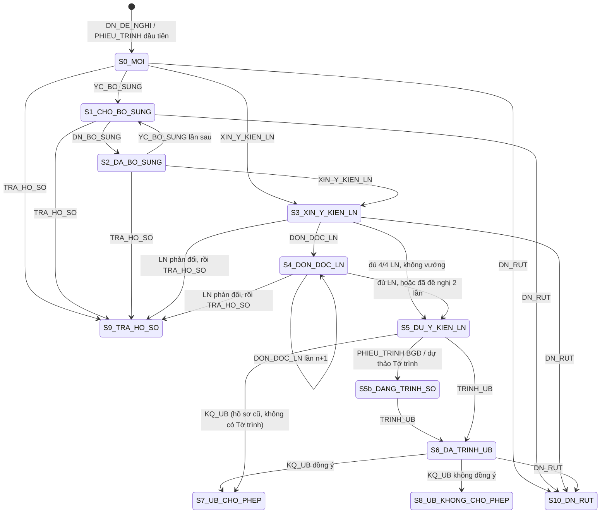

# LOGIC XỬ LÝ HỒ SƠ ABTC (THẺ ĐI LẠI DOANH NHÂN APEC)

> **Phiên bản:** v0.2 (20/10/2026). Đã hiệu chỉnh theo folder mẫu `Folder Hồ sơ ABTC Mẫu/2026, ABTC CTY Công ty P`.
> **Dùng cho:** mọi phiên làm việc khi người dùng gửi một folder hồ sơ ABTC để cập nhật `ABTC 2026.xlsx` và làm báo cáo tuần.
> **Nguyên tắc:** file Excel là dữ liệu gốc. Không ghi đè dữ liệu cán bộ đã nhập nếu chưa được xác nhận. Gặp chỗ không chắc chắn thì **hỏi lại**, không đoán.

---

## 0. Cách dùng nhanh (cho phiên làm việc sau)

1. Đọc toàn bộ file này trước khi làm.
2. Đọc hiện trạng `KẾT QUẢ/CƠ SỞ DỮ LIỆU/ABTC 2026.xlsx` bằng lệnh `doc-xlsx` của `_HE_THONG/ABTC_Tools.ps1` (đọc được cả khi file đang mở trong Excel).
3. Quét folder hồ sơ → phân loại từng file (Mục 3) → đọc **số và ngày thật** theo Mục 3.3 → trích xuất trường (Mục 4).
4. Ghép văn bản vào hồ sơ đã có hoặc tạo hồ sơ mới (Mục 6).
5. Áp dụng máy trạng thái (Mục 5) để biết phải cập nhật cột nào.
6. Chạy kiểm tra chéo (Mục 8).
7. **Hiển thị bảng thay đổi dự kiến (trước → sau) và danh sách cảnh báo cho người dùng duyệt**, rồi mới ghi vào Excel.
8. Ghi từng sự kiện vào nhật ký `_HE_THONG/ABTC_nhat_ky.csv` (Mục 9.3) để làm báo cáo tuần.

---

## 1. Cấu trúc file đích `ABTC 2026.xlsx`

- **Sheet:** `ABTC 2026`
- **Tiêu đề bảng:** dòng 2–4 (có ô gộp). **Dữ liệu bắt đầu từ dòng 5.**
- Cột J–M nằm chung dưới nhóm tiêu đề **"Tiếp tục giải quyết"** (J2:M2).

| Cột | Tiêu đề trong file | Mã trường | Nguồn dữ liệu | Cách ghi |
|---|---|---|---|---|
| A | STT | `stt` | Tự sinh = STT lớn nhất + 1 | Số |
| B | Số vb đến/ngày nộp | `so_vb_den` | Văn bản đề nghị của DN, hoặc câu "Ngày …, Văn phòng nhận được văn bản số …" trong CV xin LN | Mục 2.2 |
| C | Cán bộ thụ lý | `can_bo` | Dòng "Lưu: VT, LSLT(**Thủy**)" / "Lưu: VT, LS (**Thủy**)" | Tên gọi ngắn: An, Bình, Chi, Dung, Hà, Lan |
| D | Doanh nghiệp | `doanh_nghiep` | Văn bản DN / mục "Tên doanh nghiệp" trong CV xin LN, Tờ trình | Tên đầy đủ |
| E | Địa chỉ | `dia_chi` | Mục "Địa chỉ trụ sở chính" | Theo địa giới mới (phường/xã, Hà Nội) |
| F | Số lượng đề nghị cấp thẻ | `so_luong` | Đếm số doanh nhân | Số nguyên |
| G | Tên cá nhân đề nghị được cấp | `ds_ca_nhan` | Bảng "Thông tin về nhân sự đề nghị cấp thẻ" | Mục 2.4 |
| H | Trả hồ sơ | `tra_ho_so` | Văn bản trả hồ sơ / không đủ ĐK / DN rút | Trạng thái kết thúc |
| I | Bổ sung, giải trình hồ sơ | `bo_sung` | Văn bản yêu cầu bổ sung + văn bản bổ sung của DN | Ghi nối tiếp |
| J | Xin ý kiến LN | `xin_y_kien_ln` | CV xin ý kiến liên ngành | `{số}/{ký hiệu} ngày {dd/mm/yyyy}` |
| K | Văn bản đôn đốc liên ngành | `don_doc_ln` | Văn bản đôn đốc | **Ghi nối tiếp theo lần** (Mục 5.3) |
| L | Trình UB | `trinh_ub` | **Tờ trình của Sở Ngoại vụ** (`…/TTr-NV`) | `{số}/{ký hiệu} ngày {dd/mm/yyyy}` |
| M | Kết quả UB | `ket_qua_ub` | Văn bản của UBND TP (`…/UBND-KGVX`, trước đây `…/UBND-LSLT`) | `{số}/{ký hiệu} ngày {dd/mm/yyyy}` |
| N | Ghi chú (Tình trạng Hồ sơ) | `ghi_chu` | **Tự sinh** từ trạng thái (Mục 7) | Một câu tóm tắt |
| O | Số thẻ đã cấp trước đó | `the_da_cap` | Văn bản DN (phần thẻ đã được cấp) | Số / "Chưa" |
| P | Báo cáo tình hình sử dụng thẻ | `bc_su_dung_the` | Báo cáo hằng năm của DN **sau khi được cho phép**, hạn trước 31/12 (khoản 5 Điều 25 QĐ 28/2026/QĐ-TTg) | `Đã BC {năm}: {số} ngày {d}` |

> Lưu ý từ dữ liệu hiện có: kết quả UB đôi khi bị ghi vào cột N (dòng 84, 85), tên DN và địa chỉ bị đảo cột (dòng 139), ký hiệu kết quả UB ghi sai (dòng 112 ghi `1234/UBND-LSLT`, văn bản gốc là `1234/UBND-KGVX`). Hệ thống **chỉ cảnh báo**, không tự sửa dòng cũ (Mục 8).

---

## 2. Quy ước định dạng chung

### 2.1. Ngày
- Luôn ghi dạng chữ `dd/mm/yyyy` (ví dụ `05/10/2026`). **Không ghi số ngày kiểu Excel.**
- Đọc được các dạng: `05/10/2026`, `5/10/26`, `05.10.2026`, `26.6.26` (trong tên file), `ngày 05 tháng 10 năm 2026`, và số ngày Excel (cách đổi: `46023` = 01/01/2026; ngày = 01/01/2026 + (số − 46023); ví dụ `46262` = 28/08/2026).
- Năm 2 chữ số → thêm `20`.

### 2.2. Số văn bản
- Mẫu chuẩn: **`{số}/{ký hiệu} ngày {dd/mm/yyyy}`**, ví dụ `12345/VP-LSLT ngày 26/06/2026`, `123/TTr-NV ngày 21/09/2026`, `1234/UBND-KGVX ngày 30/09/2026`.
- **Cột B** gộp 2 thông tin: `{số văn bản DN} ngày {ngày văn bản DN} (số đến {số đến}, {ngày đến})`.
  - Ví dụ: `162/CV ngày 29/05/2026 (nhận ngày 17/06/2026)`. Chưa rõ số đến thì ghi "nhận ngày …" lấy từ câu "Ngày 17/6/2026, Văn phòng UBND Thành phố nhận được văn bản số 162/CV…" trong CV xin LN.
  - DN nộp nhiều văn bản cho cùng một đợt → đánh số `1. …; 2. …`.
- Regex gợi ý:
  - Số + ký hiệu: `Số[:\s]*([0-9]+[a-zA-Z]?)\s*/\s*([A-ZĐ0-9&.\-]+(?:/[A-ZĐ0-9&.\-]+)*)`
  - Ngày dạng chữ: `ngày\s+(\d{1,2})\s+tháng\s+(\d{1,2})\s+năm\s+(\d{4})`
  - Số + ngày trong tên file: `\((?:số\s*)?(\d+)\s*,\s*(\d{1,2})\.(\d{1,2})\.(\d{2,4})\)` → ví dụ `(12577, 26.6.26)`, `(số 139, 21.9.26)`.

### 2.3. Ký hiệu cơ quan ban hành

**Bên giải quyết hồ sơ** (có thay đổi tổ chức trong năm 2026):

| Ký hiệu | Cơ quan | Giai đoạn |
|---|---|---|
| `VP-LSLT` | Văn phòng UBND TP – Phòng Lãnh sự-Lễ tân đối ngoại | Đến khoảng giữa tháng 8/2026 |
| `NV-LS` | Sở Ngoại vụ – Phòng Lãnh sự (đánh số lại từ đầu) | Từ khoảng 22/08/2026 |
| `TTr-NV` | **Tờ trình** của Sở Ngoại vụ gửi UBND TP | Từ khi có Sở Ngoại vụ |
| `UBND-LSLT` → `UBND-KGVX` | UBND Thành phố (văn bản kết quả) | `KGVX` dùng từ khoảng tháng 8/2026 |

**Cơ quan liên ngành** (luôn gồm 4 nhóm):

| Nhóm | Ví dụ ký hiệu | Tên cơ quan thường gặp |
|---|---|---|
| `CA` – Công an | `CAHN-ANKT` | Công an TP Hà Nội |
| `THUE` – Thuế | `TMĐT-QLT3`, `TCS6-QLDN1` (mẫu chung `TCS{n}-…`) | Chi cục Thuế thương mại điện tử; Thuế cơ sở {n} TP Hà Nội |
| `BHXH` – Bảo hiểm xã hội | `BHXH-QLT` (có thể kèm văn bản `BHXH-{cơ sở}` của BHXH cơ sở) | BHXH TP Hà Nội |
| `HQ` – Hải quan | `HQKV1-NVHQ` | Chi cục Hải quan khu vực I |

**Doanh nghiệp:** ký hiệu thường là `CV` hoặc có tên DN (`CV-ENTEC`, `ABTC-Công ty T`…).

### 2.4. Danh sách cá nhân (cột G)
- Mỗi người một dòng trong ô, dạng `Họ tên, Chức danh`. Ví dụ: `Trần Thị B, Giám đốc` ↵ `Phạm Thị D, Trưởng phòng kinh doanh`.
- Bỏ `Ông/Bà`, `2.1. Họ và tên:`, ngày sinh, hộ chiếu, mã số thuế (không đưa vào bảng).
- `F` phải bằng số người trong `G`.

### 2.5. Tên doanh nghiệp
- Cột D ghi **tên đầy đủ**. Báo cáo tuần dùng **tên viết tắt** (Mục 11).
- Khi so khớp, chuẩn hóa: bỏ dấu, chữ thường, bỏ loại hình (`công ty`, `cổ phần`, `cp`, `tnhh`, `mtv`…). Ví dụ `Công ty Cổ phần Công ty S` = `Công ty CP Công ty S` = `Công ty cổ phần 9Pay`.
- Ưu tiên so khớp bằng **mã số doanh nghiệp / mã số thuế** (ví dụ `0123456789`) khi văn bản có ghi.

---

## 3. Đọc folder hồ sơ

### 3.1. Cấu trúc folder (theo mẫu Công ty S)
- **Mỗi folder = một lần đề nghị của một doanh nghiệp.** Tên folder dạng `{năm}, ABTC CTY {tên DN}`.
- Folder thường **không có văn bản đề nghị gốc của DN** (chỉ có báo cáo thuế, báo cáo BHXH của DN). Thông tin DN lấy từ CV xin LN, Phiếu trình, Tờ trình.
- Có 2 dạng file:
  - **`.pdf` = bản đã ban hành** (scan, có dấu đỏ). **Chỉ PDF mới dùng để lấy số và ngày văn bản.**
  - **`.docx` = bản dự thảo / bản làm việc** (số và ngày để trống). Chỉ dùng để lấy nội dung và biết hồ sơ đã đến bước nào.
- Tên file do cán bộ đặt, có gợi ý loại văn bản và thường kèm `(số, ngày)`:

| Tên file mẫu | Loại |
|---|---|
| `BAO CAO THUẾ.pdf`, `BAO CAO BHXH.pdf` | `DN_HO_SO_KEM` (báo cáo của DN) |
| `PHIẾU TRÌNH.docx` | `PHIEU_TRINH` – xin ý kiến lãnh đạo để gửi LN |
| `CV xin liên ngành.docx` | Dự thảo CV xin LN |
| `CV xin LN (12577, 26.6.26).pdf` | `XIN_Y_KIEN_LN` |
| `LN, CA.pdf`, `LN, Thuế.pdf`, `LN, BHXH TP.pdf`, `LN, HQ.pdf` | `LN_TRA_LOI` |
| `PHIẾU TRÌNH BGĐ.docx`, `PHIẾU TRÌNH TRẢ KẾT QUẢ.docx` | `PHIEU_TRINH` – trình kết quả |
| `(Chính) Tờ trình kết quả.docx` | Dự thảo Tờ trình |
| `(nháy) Dự thảo Văn bản của UBND TP.docx` | Dự thảo văn bản UBND (bản ký nháy) |
| `Tờ trình BC UBND (số 139, 21.9.26).pdf` | `TRINH_UB` |
| `KQ trả Công ty (4991,30.9.26).pdf` | `KQ_UB` |

### 3.1b. Hồ sơ CÓ CẤU TRÚC thư mục (từ 11/11/2026 – bộ dữ liệu chuyên viên sắp xếp)

Folder tổng có thể lồng nhiều cấp: `Folder tổng → THÁNG N → "STT. TÊN DN d.m" → thư mục loại văn bản → tệp`. Hệ thống tự hiểu:

- **Một hồ sơ** = folder có PDF/Word ngay bên trong (kiểu cũ) **hoặc** folder có thư mục con mang tên loại văn bản (kiểu mới). Folder tháng, folder tổng là thư mục gom – hệ thống đi xuống tìm hồ sơ (tối đa 5 cấp, bỏ qua `_HE_THONG`, `KẾT QUẢ`, `DỮ LIỆU GỐC`, `Báo cáo tuần`).
- **Văn bản của hồ sơ** = tệp ngay trong folder + tệp trong các thư mục loại văn bản (PDF, DOCX, ảnh JPG/PNG). Thư mục con khác (vd tài liệu đính kèm của DN) không đọc. Bỏ tệp rác `~$…`, `~WRL…`, `.tmp`.
- **Khóa văn bản** = đường dẫn tương đối (`Kết quả ý kiến LN\1. bhxh hn.pdf`); cache đặt tên `"<thư mục> - <tên tệp>"` để hai tệp cùng tên ở hai thư mục không đè nhau.

| Tên thư mục (bỏ dấu, không phân biệt hoa/thường, chấp nhận lỗi gõ) | Loại |
|---|---|
| … xin ý kiến / xin yk / xin LN … | `XIN_Y_KIEN_LN` |
| Kết quả ý kiến LN / ý kiên LN / trả lời LN | `LN_TRA_LOI` |
| Kết quả Ủy ban / Uỷ ban / UB / ub / KQ | `KQ_UB` |
| Tờ trình UB | `TRINH_UB` |
| (Đề nghị) bổ sung / giải trình | `YC_BO_SUNG` |
| Không đủ điều kiện / Không đủ đk / trả hồ sơ | `TRA_HO_SO` |
| Đôn đốc | `DON_DOC_LN` |

**Thứ tự quyết định loại một tệp trong thư mục loại văn bản:** (1) tên tệp nói rõ *phiếu trình / đôn đốc / tờ trình / dự thảo (.docx)* → theo tên; (2) tệp văn thư quét `số_vc_năm` hoặc tiêu đề bắt đầu bằng "CÔNG TY …" → công văn của DN (`DN_HO_SO_KEM`); (3) còn lại → **theo thư mục**. Thư mục được ưu tiên hơn đoán theo nội dung vì thư trả lời của LN cũng nhắc "xin ý kiến về doanh nghiệp".

**Ảnh JPG/PNG** (văn bản chụp) đọc bằng OCR như bản PDF đã ký. **Số trong tên tệp tự do:** `CAHN_9447_24122025` → 9447 ngày 24/12/2025; `CAHN_1857_1932026` → 1857 ngày 19/03/2026; `SĐ2484` → 2484; `CV37.BHXH` → 37/BHXH; `6304_11.8` → 6304. **OCR số đóng dấu:** "VP" đọc nhầm thành "NP" vẫn nhận; số và ký hiệu ở hai dòng sau nhãn "Số:" vẫn nhận; số bắt đầu bằng 0 bỏ qua (OCR có thể mất chữ số đầu).

**Ngày ở cuối tên folder DN** (`Công ty N2 16.1`, `_SĐ 60 (29.10)`, `_12.8`): tháng 1–8/2026 là ngày có **kết quả UB**, từ tháng 9 (có thư mục Tờ trình UB) là ngày **tờ trình**. Hệ thống đối chiếu với cả hai, chỉ cảnh báo khi không khớp; văn bản UB chưa đọc được ngày và hồ sơ không có tờ trình thì lấy ngày theo tên folder (năm suy từ các văn bản khác).

**Trả hồ sơ một phần** (thư mục/tệp nêu tên một người, vd `Không đủ điều kiện (ông Hải)`): không chuyển trạng thái `S9`; cột "Trả hồ sơ" ghi `<số> ngày <d> (không đủ ĐK – ông Hải)`.

**Thêm vào ứng dụng:** chọn/kéo/dán **folder tổng** → hệ thống tìm mọi hồ sơ bên trong, sao chép vào kho đang xem **giữ nhóm tháng** (`<kho>\THÁNG 1\1. Công ty N2 16.1`), phân tích lần lượt. Danh sách hồ sơ của kho tìm đệ quy, hiện nhóm ("THÁNG 1 › 1. Công ty N2 16.1").

Kiểm thử 11/11/2026 trên 25 hồ sơ tháng 1–10/2026: 24 hồ sơ `S7_UB_CHO_PHEP`; Công ty G1 `S5b` vì thư mục Kết quả Ủy ban chỉ có bản Word dự thảo, chưa có PDF văn bản UB.

### 3.2. Các loại văn bản

Phân loại theo **cơ quan ban hành + ký hiệu + trích yếu**. Tên file chỉ dùng để đối chiếu.
Công cụ quy tắc (`phan-tich`) đoán trước theo tên file (`Get-LoaiTheoTen`); PDF không đoán được thì đọc phần đầu văn bản (`Get-LoaiTheoNoiDung`: "TỜ TRÌNH", "xin ý kiến về doanh nghiệp", "thông tin kết quả hồ sơ / không đủ điều kiện", ký hiệu `UBND`, ký hiệu liên ngành…) và cảnh báo để người dùng đặt lại tên. Tên file `VB thông báo HS không đủ đk (1063, 22.10.26).pdf` = `TRA_HO_SO` (sửa 23/10/2026 sau hồ sơ Công ty K).

| Mã | Loại văn bản | Dấu hiệu nhận biết | Trường cần trích | Cột đích |
|---|---|---|---|---|
| `DN_DE_NGHI` | DN đề nghị cho phép sử dụng thẻ ABTC | DN ban hành; "đề nghị… cho phép sử dụng thẻ ABTC"; kèm danh sách doanh nhân | Số, ngày, tên DN, địa chỉ, danh sách, thẻ đã cấp | B, D, E, F, G, O |
| `DN_HO_SO_KEM` | Báo cáo thuế, báo cáo BHXH, ĐKKD, hợp đồng… của DN | DN ban hành, "Báo cáo tổng hợp các khoản thuế", "Báo cáo… nghĩa vụ BHXH" | Mã số thuế, địa chỉ, tên doanh nhân | Đối chiếu E, G |
| `PHIEU_TRINH` | Phiếu trình xử lý công việc (nội bộ) | "PHIẾU TRÌNH XỬ LÝ CÔNG VIỆC"; gửi PCVP / Giám đốc Sở / PCT UBND TP | Ngày, người nhận, đề xuất, tóm tắt hồ sơ, quá trình xử lý | Không ghi cột; dùng làm nguồn thông tin và mốc báo cáo tuần |
| `YC_BO_SUNG` | Yêu cầu DN bổ sung hồ sơ | Phòng ban hành; "bổ sung", "hoàn thiện hồ sơ" | Số, ngày, nội dung cần bổ sung | I |
| `DN_BO_SUNG` | DN bổ sung / giải trình | DN ban hành; "bổ sung", "giải trình", "BSHS" | Số, ngày | I |
| `XIN_Y_KIEN_LN` | Xin ý kiến liên ngành | `VP-LSLT`/`NV-LS`; "V/v xin ý kiến về doanh nghiệp và nhân sự đề nghị cấp văn bản cho phép sử dụng thẻ ABTC"; gửi CA, Thuế, BHXH, HQ | Số, ngày, danh sách cơ quan, ngày nhận hồ sơ DN, số văn bản DN, thông tin DN, danh sách doanh nhân | J (và B–G nếu thiếu) |
| `DON_DOC_LN` | Đôn đốc liên ngành | Phòng ban hành; "đôn đốc", "đề nghị khẩn trương", "chưa nhận được ý kiến"; viện dẫn CV xin LN | Số, ngày, cơ quan bị đôn đốc | K |
| `LN_TRA_LOI` | Ý kiến trả lời của liên ngành | Ký hiệu ở bảng 2.3; "phúc đáp / nhận được công văn số {J}" | Nhóm (CA/THUE/BHXH/HQ), số, ngày, **kết luận**, **danh sách DN được nhắc tới** | N (theo dõi) |
| `TRINH_UB` | Tờ trình UBND TP | "TỜ TRÌNH", ký hiệu `TTr-NV`; gửi UBND TP | Số, ngày, danh sách ý kiến LN đã nhận | L |
| `KQ_UB` | Văn bản kết quả của UBND TP | Ký hiệu `UBND-…`; "đồng ý cho phép được sử dụng thẻ ABTC đối với {n} doanh nhân" (hoặc không đồng ý) | Số, ngày, số người được phép, viện dẫn Tờ trình | M |
| `TRA_HO_SO` | Trả hồ sơ / không đủ điều kiện | Phòng ban hành; "trả hồ sơ", "không đủ điều kiện" | Số, ngày, lý do | H |
| `DN_RUT` | DN xin rút / dừng hồ sơ | DN ban hành; "xin rút", "dừng đề nghị" | Số, ngày | H |
| `DN_BC_SU_DUNG` | DN báo cáo tình hình sử dụng thẻ (hằng năm) | DN ban hành; "báo cáo tình hình sử dụng thẻ ABTC" | Số, ngày, năm báo cáo | P |
| `DU_THAO` | File `.docx` chưa có số (dự thảo Tờ trình, dự thảo VB UBND, dự thảo CV) | Dòng "Số:" để trống | Nội dung | Không ghi số; chỉ đánh dấu "đang dự thảo bước …" nếu chưa có bản PDF tương ứng |
| `KHAC` | Không xác định được | — | — | Hỏi người dùng |

### 3.2b. Cách đọc PDF tiết kiệm token (MẶC ĐỊNH, đã thử trên Công ty S ngày 21/10/2026: kết quả khớp 100%)
0. **Cách nhanh nhất:** chạy `& "_HE_THONG\ABTC_Tools.ps1" chuan-bi -Path "<folder>"`. Lệnh này tự làm bước 1–2 và bước 4 (chỉ cho file mới hoặc đã đổi), rồi ghi kết quả vào `_HE_THONG/cache/<tên folder>/` gồm `tom_tat.md`, các file `.txt` và `*_dau.png`. Sau đó chỉ cần đọc `tom_tat.md` và các file liên quan.
1. **Nội dung:** lệnh `pdf-chu` (Word trích chữ, khoảng 13 giây cho 9 file) rồi đọc các file `.txt`. **Không** dùng công cụ Read trên PDF để lấy nội dung.
2. **Số/ngày:** ưu tiên lấy từ tên file `(số, ngày)`. Nếu tên không có số thì dùng lệnh `pdf-dau-trang` (cắt 30% đầu trang 1, khoảng 400–500 token/ảnh) rồi đọc ảnh đó.
3. Chỉ đọc nguyên PDF bằng ảnh khi ảnh cắt không đọc được.
4. Bỏ qua: nội dung báo cáo thuế/BHXH của DN (chỉ cần số/ngày), file `.docx` dự thảo khi đã có PDF có số, file trùng (cùng mã băm).
5. Ước tính: mỗi folder từ khoảng 40 nghìn token (đọc ảnh cả trang) xuống khoảng 8–11 nghìn token.
6. Cần bật `HKCU\Software\Microsoft\Office\16.0\Word\Options\DisableConvertPdfWarning = 1` (đã bật ngày 21/10/2026). Thiếu tùy chọn này Word sẽ treo vì hộp thoại ẩn.

### 3.3. Đọc số và ngày văn bản – QUY TẮC BẮT BUỘC

Trong PDF scan, **lớp chữ (text) là của bản dự thảo nên số và ngày bị trống** (ví dụ `Số: /UBND-KGVX`, `ngày tháng năm 2026`). Số thật chỉ có trên **ảnh trang 1** (đóng số tay hoặc đóng dấu). Vì vậy:

1. **Nhìn ảnh trang 1** để đọc dòng `Số: ____ /ký hiệu` và `Hà Nội, ngày __ tháng __ năm ____`.
2. **Đối chiếu với tên file** nếu có `(số, ngày)`.
3. **Đối chiếu với văn bản sau** có viện dẫn văn bản này. Ví dụ VB UBND 4991 ghi "Tờ trình số 123/TTr-NV ngày 21/9/2026"; các văn bản LN ghi "Công văn số 12345/VP-LSLT ngày 26/6/2026".
4. Hai nguồn trở lên khớp nhau → dùng. Không khớp hoặc chỉ có một nguồn mờ → **ghi kèm `(?)` và hỏi người dùng**.
5. Ký hiệu lấy theo văn bản gốc, **không theo Excel cũ**.
- **OCR số đóng dấu mất dấu "/" (03/11/2026):** ảnh đầu trang CV xin ý kiến LN đã ký thường có số đóng dấu không kèm chữ "Số:", và OCR làm mất dấu "/" → `1284 NV-LS`. Hệ thống chấp nhận số và ký hiệu chỉ cách nhau bằng khoảng trắng **trên cùng một dòng**, bỏ qua số dạng năm (`20xx`), số dưới 3 chữ số, và vẫn đối chiếu ký hiệu với ký hiệu đọc từ chữ (`NV-LS`) trước khi nhận.

### 3.4. Văn bản lạc hồ sơ
Folder có thể chứa file mẫu của **doanh nghiệp khác** (ví dụ `PHIẾU TRÌNH TRẢ KẾT QUẢ.docx` trong folder Công ty S thực chất là của Công ty Công ty Q2). Mỗi file phải kiểm tra tên DN / mã số DN:
- Khớp DN của folder → xử lý bình thường.
- Là DN khác → **không áp dụng cho hồ sơ của folder**. Báo cho người dùng; có thể dùng làm thông tin cho hồ sơ của DN kia (Mục 6) nếu người dùng đồng ý.

### 3.5. Văn bản liên ngành trả lời chung nhiều DN
Một văn bản LN có thể trả lời cho nhiều hồ sơ. Ví dụ `1234/CAHN-ANKT ngày 11/08/2026` của Công an TP trả lời 5 DN (FSI, Xúc tiến toàn cầu Hà Nội, Công ty S, XNK Công ty H1, Công ty R2 Việt Nam) và viện dẫn 5 CV xin LN (`12233`, `12578`, `12577`, `11595`, `11961`/VP-LSLT).
→ Cập nhật trạng thái LN cho **tất cả** hồ sơ có cột J khớp một trong các số được viện dẫn, không chỉ hồ sơ của folder. Liệt kê các dòng bị ảnh hưởng trong bảng thay đổi.

---

## 4. Trích xuất thông tin hồ sơ

Nguồn ưu tiên (từ cao xuống): `DN_DE_NGHI` → `XIN_Y_KIEN_LN` (PDF) → `PHIEU_TRINH` → `TRINH_UB` → `KQ_UB`.

| Trường | Lấy ở đâu | Quy tắc |
|---|---|---|
| `doanh_nghiep` | "Tên doanh nghiệp:" | Giữ nguyên cách viết của văn bản nguồn ưu tiên nhất |
| `ma_so_dn` | "Giấy chứng nhận đăng ký doanh nghiệp số …", "Mã số thuế:" | Chỉ dùng để so khớp, không ghi cột riêng |
| `dia_chi` | "Địa chỉ trụ sở chính:" / "Trụ sở chính:" | Lấy trụ sở chính theo văn bản DN / CV xin LN |
| `so_vb_dn`, `ngay_vb_dn` | "nhận được văn bản số 162/CV ngày 29/05/2026" | Mục 2.2 |
| `ngay_nhan` | "Ngày 17/6/2026, Văn phòng UBND Thành phố nhận được…" | Đưa vào phần ngoặc của cột B |
| `ds_ca_nhan` | Bảng "Thông tin về nhân sự đề nghị cấp thẻ ABTC" (Họ tên, Chức vụ) | Mục 2.4 |
| `so_luong` | Đếm từ `ds_ca_nhan`; đối chiếu "đối với 02 doanh nhân" | Lệch → cảnh báo |
| `can_bo` | Dòng "Lưu: VT, LSLT(An)" / "Lưu: VT, LS(An)" của văn bản do phòng ban hành | Nhận cả dạng không ngoặc `LSAn`, `LS Bình`, `LS-Chi`, `LSLTDung` (09/11/2026); kiểu bỏ dấu cũ `Thuỷ` quy về `Thủy`. Không có → hỏi người dùng |
| `the_da_cap` | Đoạn "đã được cấp thẻ ABTC…" | Không thấy → để trống |

### 4.1. Các cách ghi gặp thực tế (case Công ty G 30/10/2026 và biến thể)
Hồ sơ chỉ có 3 file: **công văn đề nghị của DN (PDF bản quét, OCR kém)**, **phiếu trình (.docx)**, **dự thảo công văn trả hồ sơ (.docx)**. Chưa có công văn trả đã ký nên trạng thái giữ `S0_MOI`, nhưng thông tin hồ sơ phải đọc đủ từ phiếu trình. Hệ thống nhận các cách ghi sau:

| Trường | Cách ghi được nhận |
|---|---|
| Số + ngày văn bản của DN | "văn bản số / Công văn số / CV số / Tờ trình số / Đơn số … [ký] ngày d/m/yyyy"; "Văn bản đề nghị của Công ty số: …"; ngày bằng chữ "ngày 23 tháng 10 năm 2026" |
| Ngày nhận | "(nhận hồ sơ ngày d/m/yyyy)" trên phiếu trình, "(nhận ngày …)", "Ngày nhận hồ sơ: …", "tiếp nhận hồ sơ …" – **ưu tiên hơn** câu "Ngày …, Sở Ngoại vụ nhận được …" (câu này trong dự thảo có thể chỉ là ngày văn bản của DN) |
| Doanh nhân | Bảng; dòng "ông/bà Họ Tên, Chức danh"; **danh sách gạch đầu dòng** "Họ và tên / Ngày sinh (hoặc Ngày tháng năm sinh, Sinh ngày) / Chức vụ" theo thứ tự bất kỳ, nhiều người liên tiếp |
| Doanh nhân (09/11/2026, case Công ty M) | Phiếu trình đánh số "(1) Nguyễn Văn A, sinh ngày 01/01/1980; - Chức danh: Phó Tổng Giám đốc"; câu "đối với 01 nhân sự của Công ty: bà X, Phó Tổng Giám đốc" trong **CV đề nghị DN bổ sung** (loại YC_BO_SUNG nay cũng là nguồn đọc thông tin hồ sơ, xếp ưu tiên cuối) |
| Doanh nhân (11/11/2026, mẫu văn bản mới) | "Họ tên: X ⏎ Sinh ngày: … ⏎ Chức vụ: …" (không có "và") trong tờ trình, VB UB, phiếu trình; "Bà X, sinh ngày: 01/01/1980; Hộ chiếu số …; Chức danh: …" trong VB UB/tờ trình (luôn đọc, cộng dồn với nguồn khác); bảng trong PDF mà Word trích **mỗi ô một dòng** ("1 ⏎ Lê Văn C ⏎ Trưởng phòng Tài chính ⏎ 01/01/1980", ô chức vụ có thể xuống 2–3 dòng) – chỉ dùng khi các cách khác không ra ai |
| Số + ngày CV xin ý kiến LN (11/11/2026) | Không đọc được trên bản quét → lấy từ **văn bản khác trích dẫn lại**: "Phúc đáp Công văn số 12345/VP-LSLT ngày 10/8/2026" (LN trả lời, đôn đốc, tờ trình, VB UB, phiếu trình); chọn số được trích nhiều nhất, khớp ký hiệu và số/ngày đã biết, bỏ số của văn bản khác. OCR: số dính ký hiệu "8270VP-LSLT"; nhãn "Số" đọc thành "s6:"; ký hiệu NV-LS cho phép số 2 chữ số (Sở đánh số lại từ 7/2026, vd 12/NV-LS); số bắt đầu bằng 0 bỏ qua (OCR mất chữ số đầu). Tên tệp "…8270LSLT" → 1234/VP-LSLT |
| Số + ngày VB LN TRẢ LỜI (11/11/2026) | Thứ tự: (1) tên tệp chuẩn / lớp chữ / OCR; (2) **mốc ký hiệu**: số đứng ngay trước `QLDN / NVHQ / ANKT / BHXH-` (chịu ký hiệu bị méo "T--IAN-QLDNI", "rrCS8-QLDN1"; bỏ số dính chữ cái phía trước như "13" trong "TCS13", số kèm "?", số bắt đầu bằng 0); (3) số đứng riêng trong tên tệp ("thuế 20470"), **"SĐ…" là số đến – không phải số văn bản**; (4) ngày theo **chữ ký số** "Thời gian ký: 09.01.2026", rồi ngày **"SAO Y; …; 04/11/2025"**, rồi ngày d.m trong tên tệp (năm theo CV xin); (5) **đối chiếu tờ trình / phiếu trình kết quả / VB UB** – nơi cán bộ gõ lại "Công văn số 1234/HAN-QLDN1 ngày 30/01/2026": ghép theo cơ quan (theo số, theo ngày, hoặc còn đúng 1 văn bản – 1 số), **ưu tiên hơn OCR/chữ ký số/sao y** nhưng không đè nhập tay / tên file / lớp chữ; chỉ nhận số có ngày ≥ ngày CV xin ý kiến và lệch ngày ≤ 3 ngày khi văn bản đã có ngày; khác số OCR thì ghi cảnh báo. Giấy nộp tiền NSNN, ủy nhiệm chi, "giải trình" để trong thư mục LN → văn bản của DN |
| Công văn đề nghị của DN dạng PDF quét | Tên file "Công văn đề nghị", "CV đề nghị", "Văn bản đề nghị", "Công văn của Cty…" → `DN_HO_SO_KEM`; tên không rõ thì đoán theo nội dung ("Kính gửi: UBND…", ký hiệu `…/2026/CV-…`) và có cảnh báo |

Nguyên tắc: số/ngày của DN không đọc được từ bản quét thì lấy từ phiếu trình/dự thảo (vì đã được cán bộ đối chiếu), không bắt người dùng nhập tay.

### 4.2. QUY TẮC BẮT BUỘC: quét kỹ toàn bộ phiếu trình (áp dụng cho MỌI hồ sơ)
Mỗi lần phân tích, hệ thống đọc **toàn bộ nội dung phiếu trình** (mọi phiếu trình trong folder, kể cả ô bảng ngắt dòng bằng "/") để lấy đủ thông tin, không chỉ ngày và số văn bản. Kết quả nằm ở trường `thong_tin_phieu_trinh` và hiện trong ứng dụng (ghi chú "phiếu trình").

| Mục lấy | Dòng trong phiếu trình | Dùng để |
|---|---|---|
| Địa chỉ | "Địa chỉ trụ sở chính [(cũ theo đăng ký DN)]: …" | Điền cột E nếu các văn bản khác chưa có |
| GCN đăng ký DN, mã số DN | "Giấy chứng nhận đăng ký doanh nghiệp số …; đăng ký lần đầu …; thay đổi lần thứ …" | Điền mã số DN nếu thiếu |
| Lĩnh vực, người đại diện | "Lĩnh vực hoạt động:", "Người đại diện theo pháp luật:" | Hiển thị, đối chiếu |
| Doanh nhân | "Họ và tên / Ngày sinh / Số định danh / Chức vụ / Hộ chiếu số …, cấp ngày …, có giá trị đến …" | Danh sách cột G, thêm CCCD và hộ chiếu từng người |
| Số đến, văn bản trình | "Số: 4318 (nhận hồ sơ ngày …)", "Văn bản trình", "Vấn đề trình" | Ngày nhận, số/ngày văn bản của DN |

Nguyên tắc: phiếu trình chỉ **điền chỗ còn thiếu**, không ghi đè thông tin đã đọc từ văn bản khác. Quét xong vẫn thiếu địa chỉ hoặc mã số DN thì hiện cảnh báo để nhập tay. Địa chỉ cắt trước dấu "/" của ô bảng.

---

## 5. Máy trạng thái (phần cốt lõi)

### 5.1. Quy trình thực tế (rút ra từ hồ sơ Công ty S)

```
DN nộp hồ sơ (CV đề nghị + BC thuế + BC BHXH + hợp đồng, hộ chiếu, QĐ bổ nhiệm…)
  → PHIẾU TRÌNH gửi Phó Chánh VP: rà soát điều kiện, đề xuất xin ý kiến LN   (22/06)
  → CV xin ý kiến LN gửi 4 cơ quan: CA, Thuế, BHXH, HQ; hạn trả lời 20 ngày   (12345/VP-LSLT, 26/06)
  → Nhận ý kiến LN: HQ (02/07), BHXH (14/07), CA (11/08), Thuế (28/08)
      ↳ quá hạn thì có văn bản đôn đốc; đã đề nghị 2 lần mà vẫn chưa trả lời
        thì được tiếp tục giải quyết (mẫu Công ty Q2: đôn đốc CA bằng 12345/VP-LSLT)
  → PHIẾU TRÌNH BGĐ Sở Ngoại vụ, kèm dự thảo Tờ trình + dự thảo VB UBND       (18/09)
  → TỜ TRÌNH Sở Ngoại vụ gửi UBND TP                                         (123/TTr-NV, 21/09)
  → VĂN BẢN UBND TP cho phép sử dụng thẻ (hiệu lực 06 tháng)                  (1234/UBND-KGVX, 30/09)
  → DN báo cáo tình hình sử dụng thẻ trước 31/12 hằng năm                     (cột P)
```

> **Trước khi có Sở Ngoại vụ** (trước khoảng giữa tháng 8/2026): phòng trình thẳng Phó Chủ tịch UBND TP bằng Phiếu trình, **không có Tờ trình** → cột L để trống là bình thường với các hồ sơ cũ.
> **Căn cứ pháp lý:** QĐ 09/2023/QĐ-TTg (cũ) → **QĐ 28/2026/QĐ-TTg ngày 29/5/2026** (hiện hành).

### 5.2. Các trạng thái

| Mã | Trạng thái | Kết thúc? | Nhóm trong báo cáo tuần |
|---|---|---|---|
| `S0_MOI` | Mới tiếp nhận, đang rà soát | | Hồ sơ mới / Đang xử lý |
| `S1_CHO_BO_SUNG` | Đã yêu cầu DN bổ sung, đang chờ | | Bổ sung hồ sơ |
| `S2_DA_BO_SUNG` | DN đã bổ sung, chờ rà soát lại | | Đang xử lý |
| `S3_XIN_Y_KIEN_LN` | Đã gửi xin ý kiến LN, đang chờ trả lời | | Xin ý kiến LN |
| `S4_DON_DOC_LN` | Đã đôn đốc LN (lần n) | | Đôn đốc LN |
| `S5_DU_Y_KIEN_LN` | Đủ ý kiến LN (hoặc được phép tiếp tục), chờ trình | | Đủ ý kiến / Rà soát HS đủ ĐK sau LN |
| `S5b_DANG_TRINH_SO` | Đã có Phiếu trình BGĐ / dự thảo Tờ trình, chưa có Tờ trình số | | Đang trình |
| `S6_DA_TRINH_UB` | Đã có Tờ trình gửi UBND TP | | Trình UB |
| `S7_UB_CHO_PHEP` | UBND TP cho phép sử dụng thẻ | ✔ | Cho phép sử dụng |
| `S8_UB_KHONG_CHO_PHEP` | UBND TP không cho phép | ✔ | Không đủ ĐK |
| `S9_TRA_HO_SO` | Trả hồ sơ / không đủ điều kiện | ✔ | Không đủ ĐK / Trả hồ sơ |
| `S10_DN_RUT` | DN xin rút / dừng | ✔ | DN rút hồ sơ |

### 5.3. Sơ đồ chuyển trạng thái



### 5.4. Cập nhật cột theo từng sự kiện

| Sự kiện | Cột ghi | Kiểu ghi | Nội dung | Trạng thái mới |
|---|---|---|---|---|
| `DN_DE_NGHI` | A–G, O | Tạo dòng mới | Mục 4 | `S0_MOI` |
| `PHIEU_TRINH` (đầu tiên, đề xuất xin LN) | — (chỉ tạo dòng nếu chưa có) | Tạo dòng mới nếu chưa có hồ sơ | Thông tin DN từ phiếu | `S0_MOI` |
| `YC_BO_SUNG` | I | **Nối tiếp** | `{số}/{kh} ngày {d} (đề nghị bổ sung HS)` | `S1_CHO_BO_SUNG` |
| `DN_BO_SUNG` | I | **Nối tiếp** | `DN bổ sung: {số} ngày {d}` | `S2_DA_BO_SUNG` |
| `XIN_Y_KIEN_LN` | J (+ B–G nếu trống) | Ghi; đã có số khác → nối tiếp và cảnh báo | `{số}/{kh} ngày {d}` | `S3_XIN_Y_KIEN_LN` |
| `DON_DOC_LN` | K | **Nối tiếp, đánh số lần** | `Lần 1: {số}/{kh} ngày {d} ({nhóm LN bị đôn đốc})` ↵ `Lần 2: …` | `S4_DON_DOC_LN` |
| `LN_TRA_LOI` | N (qua ghi chú) | Cập nhật bảng theo dõi LN (5.5) | — | `S5` khi đủ điều kiện |
| `PHIEU_TRINH` (trình kết quả) / `DU_THAO` Tờ trình | — | Không ghi số | — | `S5b_DANG_TRINH_SO` |
| `TRINH_UB` | L | Ghi | `{số}/TTr-NV ngày {d}` | `S6_DA_TRINH_UB` |
| `KQ_UB` | M | Ghi | `{số}/{kh} ngày {d}`; không đồng ý thêm ` (không đồng ý)`; cho phép một phần thêm ` (cho phép x/y người)` | `S7` / `S8` |
| `TRA_HO_SO` | H | Ghi | `{số}/{kh} ngày {d}` + lý do ngắn, ví dụ ` (không đủ ĐK)` | `S9_TRA_HO_SO` |
| `DN_RUT` | H | Ghi | `DN xin rút hồ sơ: {số} ngày {d}` | `S10_DN_RUT` |
| `DN_BC_SU_DUNG` | P | Nối tiếp theo năm | `Đã BC {năm}: {số} ngày {d}` | giữ `S7` |

**Quy tắc chung:**
- Xử lý văn bản theo **ngày ban hành tăng dần**.
- **Không lùi trạng thái.** Văn bản cũ hơn trạng thái hiện tại chỉ được điền vào cột đang trống.
- **Trùng lặp:** cùng số + ký hiệu đã có trong cột → bỏ qua.
- **Hồ sơ đã kết thúc** (S7–S10) mà có đề nghị mới của DN → tạo **dòng mới**. Ví dụ Công ty S có 2 hồ sơ: dòng 88 (2411/CV, năm 2025) và dòng 112 (162/CV, năm 2026).
- Lần đôn đốc `n` = số dòng "Lần …" đã có trong K + 1.

### 5.5. Theo dõi ý kiến liên ngành
Mỗi hồ sơ có bảng 4 ô: `CA`, `THUE`, `BHXH`, `HQ`. Mỗi ô ở một trong các trạng thái `chờ` / `đã trả lời (số, ngày, kết luận)` / `đã đôn đốc n lần`.

- Kết luận **không vướng** khi văn bản ghi các ý như: "chưa phát hiện vi phạm", "không nợ thuế", "không có quyết định xử phạt", "đã đóng BHXH hết tháng …", "các vi phạm: không".
- Khoản **nợ nhỏ** (ví dụ HQ: "nợ phí hải quan 60.000 đồng") → ghi lại trong ghi chú, **không coi là phản đối**. Để người dùng tự đánh giá.
- Chuyển `S5_DU_Y_KIEN_LN` khi:
  - đủ 4/4 cơ quan trả lời và không vướng; **hoặc**
  - cơ quan còn thiếu đã được đề nghị **2 lần** (CV xin LN + ít nhất 1 lần đôn đốc) và quá hạn 20 ngày, kèm ghi chú `Tiếp tục giải quyết khi thiếu ý kiến {nhóm}`.
- Có ý kiến vướng (nợ thuế, vi phạm, tạm hoãn xuất cảnh…) → giữ trạng thái, cảnh báo, **hỏi người dùng** có trả hồ sơ không.

---

## 6. Ghép văn bản với hồ sơ đã có trong Excel

Thứ tự ưu tiên:
1. **Số CV xin LN:** văn bản LN, đôn đốc, Tờ trình, KQ UB đều viện dẫn số ở cột J → tìm dòng có J chứa số đó (ví dụ `12577`).
2. **Số văn bản DN:** "văn bản số 162/CV ngày 29/5/2026 của Công ty …" → dòng có B chứa `162/CV` **và** D khớp tên DN.
3. **Mã số DN + danh sách người:** khớp mã số DN hoặc tên DN, **và** có ít nhất một tên cá nhân trùng → chọn hồ sơ chưa kết thúc gần nhất.
4. Không khớp → tạo dòng mới (chỉ khi có `DN_DE_NGHI`, `PHIEU_TRINH` đầu tiên hoặc `XIN_Y_KIEN_LN`). Loại văn bản khác mà không tìm thấy hồ sơ → **báo người dùng**, không tự tạo.

> Một DN có thể có nhiều hồ sơ (Công ty S, Weldcom, Visimex, Nguyên Giáp, Novamed…). **Không** ghép chỉ bằng tên DN. Phải khớp thêm số văn bản hoặc tên cá nhân.

---

## 7. Sinh ghi chú tình trạng (cột N)

| Trạng thái | Mẫu ghi chú |
|---|---|
| `S0_MOI` | `Mới tiếp nhận {ngày nhận}; đang rà soát` |
| `S1_CHO_BO_SUNG` | `Chờ DN bổ sung (YC {số} ngày {d})` |
| `S2_DA_BO_SUNG` | `DN đã bổ sung ngày {d}; đang rà soát lại` |
| `S3_XIN_Y_KIEN_LN` | `Đang xin ý kiến LN ({x}/4): đã có {CA, HQ…}; chờ {Thuế…}` |
| `S4_DON_DOC_LN` | `Đã đôn đốc lần {n} ngày {d}; chờ {nhóm}` |
| `S5_DU_Y_KIEN_LN` | `Đủ ý kiến LN (4/4); chờ trình` hoặc `Tiếp tục giải quyết khi thiếu ý kiến {nhóm}` |
| `S5b_DANG_TRINH_SO` | `Đang trình BGĐ Sở (phiếu trình ngày {d})` |
| `S6_DA_TRINH_UB` | `Đã trình UB ({số}/TTr-NV ngày {d}); chờ kết quả` |
| `S7_UB_CHO_PHEP` | `Hoàn thành – UB cho phép {x}/{y} doanh nhân; VB hiệu lực đến {ngày KQ + 6 tháng}` |
| `S8_UB_KHONG_CHO_PHEP` | `Hoàn thành – UB không cho phép` |
| `S9_TRA_HO_SO` | `Đã trả hồ sơ – {lý do}` |
| `S10_DN_RUT` | `DN rút hồ sơ ngày {d}` |

Có điểm cần lưu ý từ LN (ví dụ nợ phí HQ) thì nối thêm: ` | Lưu ý: HQ nợ phí 60.000đ`.
Cột N đang có nội dung → so sánh trước khi đề xuất (sửa 23/10/2026, tránh ghi lặp):
- Nội dung hiện có **đã chứa** ghi chú mới → không đề xuất gì.
- Ghi chú mới **bắt đầu bằng** nội dung hiện có (chỉ thêm phần `| Lưu ý…`) → đề xuất thay cả ô bằng ghi chú mới.
- Khác hẳn (ví dụ **do cán bộ nhập tay**) → không ghi đè, nối thêm sau ` | `.

---

## 8. Kiểm tra chéo và cảnh báo

Mỗi lần chạy, liệt kê cảnh báo cho người dùng. **Không tự sửa** dòng cũ và **không tự sửa** văn bản đã ban hành.

**Đối chiếu giữa các văn bản trong folder:**
- **Ngày sinh doanh nhân** khác nhau giữa các văn bản → cảnh báo mức cao.
  - Mẹo kiểm tra: CCCD 12 số, chữ số thứ 4 là thế kỷ và giới tính (0/1 = 1900–1999, 2/3 = 2000–2099), chữ số thứ 5–6 là năm sinh. Ví dụ `024090000000` → sinh năm **1990**.
- **Địa chỉ DN** khác nhau giữa các văn bản (ví dụ CA ghi địa chỉ cũ).
- **Số văn bản viện dẫn** sai (ví dụ phiếu trình ghi số CV xin LN của hồ sơ khác).
- **Số lượng doanh nhân** trong KQ UB khác số đề nghị.
- File thuộc **DN khác** nằm trong folder (Mục 3.4).
- Số/ngày đọc từ ảnh không khớp tên file hoặc văn bản viện dẫn (Mục 3.3).

**Đối chiếu với Excel:**
- Giá trị trong Excel khác văn bản gốc (ví dụ ký hiệu `UBND-LSLT` ≠ `UBND-KGVX`).
- `F` khác số người trong `G`.
- Cột D trông giống địa chỉ, cột E trông giống tên công ty → nghi đảo cột.
- Cột B là số Excel hoặc chỉ ghi `Tháng 9`.
- Ngày sai (`//`, năm 5 chữ số, tháng > 12).
- Kết quả UB nằm ở cột N thay vì M.
- Ghi chữ thay cho số văn bản (`Hồ sơ liên ngành` ở cột H, `Đang trình` ở cột J), lỗi chính tả (`Trà hồ sơ`).

**Nhắc việc:**
- `S3/S4` quá **20 ngày** kể từ CV xin LN (hoặc lần đôn đốc gần nhất) mà còn cơ quan chưa trả lời → gợi ý đôn đốc.
- `S7`: văn bản cho phép sắp hết hiệu lực 6 tháng; DN chưa có báo cáo sử dụng thẻ khi gần 31/12 → nhắc.

---

## 9. Quy trình chạy chi tiết

### 9.1. Đầu vào
- Đường dẫn folder hồ sơ (một folder = một hồ sơ). Có thể gửi nhiều folder một lần.

### 9.2. Các bước
1. Liệt kê file (đệ quy), bỏ qua file tạm (`~$*`, `.tmp`).
2. Với mỗi file:
   - Chạy `chuan-bi` (xem 3.2b) để có sẵn chữ của `.docx`/`.pdf` và ảnh đầu trang.
   - `.pdf` → công cụ Read (xem cả ảnh trang 1 để lấy số/ngày; PDF trên 10 trang thì đọc theo trang).
   - Ảnh → đọc trực tiếp.
3. Phân loại (Mục 3.2), đọc số/ngày (Mục 3.3), kiểm tra DN của file (Mục 3.4).
4. Lập bảng văn bản: `file | loại | cơ quan | số/ký hiệu | ngày | nguồn số (ảnh/tên file/viện dẫn) | DN | ghi chú`.
5. Sắp theo ngày tăng dần → ghép hồ sơ (Mục 6) → áp dụng sự kiện (Mục 5.4) → ghi chú (Mục 7).
6. Văn bản LN trả lời chung → cập nhật thêm các dòng khác (Mục 3.5).
7. Kiểm tra chéo (Mục 8).
8. **Trình người dùng:** bảng văn bản, bảng thay đổi Excel (dòng, cột, cũ → mới), trạng thái cũ → mới, cảnh báo.
9. Người dùng đồng ý → sao lưu, ghi Excel (Mục 9.4), ghi nhật ký (Mục 9.3).

### 9.3. Nhật ký sự kiện `_HE_THONG/ABTC_nhat_ky.csv`
Excel chỉ lưu kết quả cuối, nên mỗi sự kiện ghi một dòng để làm báo cáo tuần (UTF-8 có BOM):
```
ngay_su_kien,ngay_xu_ly,dong_excel,doanh_nghiep,ten_viet_tat,can_bo,su_kien,so_van_ban,trang_thai_truoc,trang_thai_sau,file_nguon
26/06/2026,20/10/2026,112,Công ty Cổ phần Công ty S,Công ty S,Thủy,XIN_Y_KIEN_LN,12345/VP-LSLT,S0_MOI,S3_XIN_Y_KIEN_LN,2026, ABTC CTY Công ty P\CV xin LN (12577, 26.6.26).pdf
```
Chống ghi trùng khi ghi lại cùng hồ sơ: khóa = `dòng Excel | ngày sự kiện | sự kiện | số văn bản` (có ngày để các phiếu trình không số không bị gộp làm một; sự kiện có số văn bản vẫn khớp với dòng cũ ghi theo khóa không ngày). `trang_thai_truoc` = trạng thái sau của sự kiện liền trước; `trang_thai_sau` do phân tích theo quy tắc tính chạy dần theo ngày (`su_kien[*].trang_thai_sau`).

### 9.4. Ghi vào Excel
- **File đích:** `KẾT QUẢ/CƠ SỞ DỮ LIỆU/ABTC 2026.xlsx`. File này đã chứa toàn bộ 200 hồ sơ cũ, **giữ đúng số dòng như file gốc** (dòng 5–204). Hồ sơ mới thêm từ dòng 205 trở đi, chép định dạng từ dòng trên (xem `TEMPLATE_MAP.md` Mục 2). File gốc `DỮ LIỆU GỐC/ABTC 2026.xlsx` **chỉ đọc**.
- Máy không có Python. Ghi bằng **Excel COM qua PowerShell** (`New-Object -ComObject Excel.Application`) để giữ định dạng và ô gộp.
- File nằm trên OneDrive và có thể đang mở: nhờ người dùng lưu và đóng file, hoặc gắn vào phiên Excel đang chạy (`[Runtime.InteropServices.Marshal]::GetActiveObject('Excel.Application')`).
- **Cách ghi chuẩn:** lập file `_HE_THONG/thay_doi/{yyyy-MM-dd}_{DN}.json` gồm các ô đã duyệt (`sheet`, `o`, `cu`, `moi`), rồi chạy lệnh `ghi-thay-doi` của `ABTC_Tools.ps1`. Lệnh tự sao lưu và từ chối ghi nếu ô đã bị người khác sửa. Ví dụ: `thay_doi/2026-10-20_Công ty S.json`.
- **Sao lưu trước khi ghi:** `_HE_THONG/backup/ABTC 2026_{yyyyMMdd_HHmmss}.xlsx` (lệnh `ghi-thay-doi` tự làm).
- Ô nhiều dòng dùng xuống dòng `` `n `` và bật Wrap Text.
- Đặt `NumberFormat = "@"` trước khi ghi ngày để Excel không đổi thành số.
- Dòng mới thêm dưới dòng dữ liệu cuối, chép định dạng từ dòng trên.

---

## 10. Đưa vào báo cáo tuần (Mục "4. Hồ sơ cho phép sử dụng thẻ APEC")

### 10.1. Vị trí trong mẫu báo cáo
Bảng chính, phần **I. Nhiệm vụ trong tuần đã, đang thực hiện → dòng 4 "Hồ sơ cho phép sử dụng thẻ APEC"**. Mỗi cán bộ một dòng con: Nội dung | Kết quả tự đánh giá (`Đã HT` / `Đang XL`) | Chậm muộn | Cán bộ (`Đ/c {Tên}`).

### 10.2. Cách gom (tuần = Thứ Hai → Thứ Sáu, theo `ngay_su_kien`)

| Nhóm trong báo cáo | Điều kiện (sự kiện trong tuần) |
|---|---|
| Hồ sơ mới | Ngày nhận hồ sơ DN, hoặc `PHIEU_TRINH` đầu tiên |
| Bổ sung hồ sơ | `YC_BO_SUNG` / `DN_BO_SUNG` |
| Xin ý kiến LN | `XIN_Y_KIEN_LN` |
| Đôn đốc LN | `DON_DOC_LN` |
| Đủ ý kiến LN | Chuyển sang `S5_DU_Y_KIEN_LN` |
| Đang trình | `PHIEU_TRINH` trình kết quả / dự thảo Tờ trình |
| Trình UB kết quả | `TRINH_UB` |
| Cho phép sử dụng | `KQ_UB` đồng ý |
| Không đủ ĐK | `TRA_HO_SO` (không đủ ĐK) / `KQ_UB` không đồng ý |
| Trả hồ sơ / DN rút | `TRA_HO_SO` (lý do khác) / `DN_RUT` |
| Đang xử lý | Hồ sơ của cán bộ ở `S0`/`S2` không có sự kiện khác trong tuần |

- **"Xử lý NN hồ sơ"** = số hồ sơ khác nhau có ít nhất một sự kiện trong tuần (2 chữ số: `05`).
- **Kết quả tự đánh giá:** `Đã HT` nếu mọi hồ sơ có sự kiện trong tuần đều đã có văn bản đi; còn lại `Đang XL`.

### 10.3. Mẫu câu
```
Xử lý 05 hồ sơ:
- Hồ sơ mới: ATL, Novamed.
- Xin ý kiến LN: Công ty K1.
- Đôn đốc LN: Công ty P2 (lần 2).
- Trình UB kết quả: Công ty S.
- Cho phép sử dụng: Hữu Nghị.
- Không đủ đk: Weldcom, Neala.
- Đang xử lý: Công ty L1, DCS.
```
Bỏ nhóm không có hồ sơ (hoặc ghi `: 0` nếu người dùng muốn giữ).

---

## 11. Bảng tên viết tắt doanh nghiệp (học dần)

Quy tắc: bỏ loại hình (`Công ty`, `Cổ phần`, `CP`, `TNHH`, `MTV`, `Tập đoàn`, `Tổng công ty`) và cụm chung (`Thương mại`, `Xuất nhập khẩu`, `Đầu tư`, `Công nghệ`, `Việt Nam`…), giữ phần tên riêng. Khi người dùng sửa, **thêm vào bảng**.

| Tên đầy đủ (cột D) | Tên viết tắt |
|---|---|
| Công ty Cổ phần Công ty S | Công ty S |
| Công ty cổ phần đầu tư và thương mại Công ty Q2 | Công ty Q2 |
| Công ty Cổ phần Sóng thần Hà Nội | Sóng thần |
| Công ty Cổ phần Novamed Việt Nam | Novamed |
| Công ty Cổ phần Đầu tư Thương mại và giải pháp quốc tế ANT Group | ANT Group |
| Công ty Cổ phần chuyển phát quốc tế ATL | ATL |
| Công ty B1 | Hữu Nghị |
| Công ty Cổ phần Công nghiệp Weldcom | Weldcom |
| Công ty Cổ phần nhân lực Công ty G1 | Công ty G1 |
| Công ty TNHH Xuất nhập khẩu Neala | Neala |
| Công ty cổ phần thương mại và nội dung số Việt | Nội dung số Việt |
| Công ty Cổ phần Netnam | Netnam |
| Công ty A1 | Công ty P2 |
| Công ty Y | Công ty E1 |
| Công ty C1 | Công ty L1 |
| Công ty TNHH Sản xuất và Dịch vụ DCS | DCS |
| Công ty D1 | Công ty K1 |
| Công ty TNHH Draho Việt Nam | Draho |
| Công ty Cổ phần Thương mại Dầu khí An Dương | An Dương |
| Công ty TNHH Thiết bị Phụ tùng Phương Duyên | Phương Duyên |
| Công ty TNHH Xuất nhập khẩu và Thương mại Công ty M1 | Công ty M1 |

---

## 12. Giả định đang chờ xác nhận

| # | Nội dung | Tình trạng |
|---|---|---|
| G1 | Mỗi folder = một hồ sơ của một DN | ✔ Xác nhận qua folder mẫu Công ty S |
| G2 | PDF = bản ban hành (scan), DOCX = dự thảo | ✔ Xác nhận qua folder mẫu |
| G3 | Cơ quan LN gồm CA, Thuế, BHXH, HQ | ✔ Xác nhận qua CV 12577 |
| G4 | Cột L = Tờ trình `TTr-NV` của Sở Ngoại vụ | ✔ Suy ra từ folder mẫu, cần người dùng xác nhận |
| G5 | Đôn đốc ghi nối tiếp tất cả các lần vào cột K | Chờ xác nhận |
| G6 | Trả hồ sơ, không đủ ĐK, DN rút đều ghi cột H | Chờ xác nhận |
| G7 | Ghi vào `KẾT QUẢ/CƠ SỞ DỮ LIỆU/ABTC 2026.xlsx` sau khi người dùng duyệt; 200 dòng cũ đã chuyển sang | ✔ Xác nhận 20/10/2026 |
| G8 | Cột B: khi không có số đến thì ghi "nhận ngày …" | Chờ xác nhận (số `4302` ở đầu Phiếu trình có thể là số đến) |
| G9 | Thiếu ý kiến LN sau 2 lần đề nghị thì được tiếp tục giải quyết | Suy ra từ mẫu Công ty Q2, cần xác nhận |

---

## 13. Ví dụ chạy thử: folder `2026, ABTC CTY Công ty P`

> **Đã chạy thật ngày 20/10/2026** (người dùng duyệt): ghi B112, L112, M112, N112 và bổ sung ngày cho J21 (Công ty R2, lấy từ văn bản CA 6304). 10 sự kiện đã ghi vào `ABTC_nhat_ky.csv`. Thay đổi lưu tại `thay_doi/2026-10-20_Công ty S.json`.

### 13.1. Bảng văn bản nhận diện được

| Ngày | File | Loại | Số / ký hiệu | Nguồn số |
|---|---|---|---|---|
| 15/05/2026 | BAO CAO BHXH.pdf | DN_HO_SO_KEM | 21.2026/CV (viết tay, khó đọc) | Ảnh |
| 29/05/2026 | BAO CAO THUẾ.pdf | DN_HO_SO_KEM | 163/CV | Ảnh |
| 22/06/2026 | PHIẾU TRÌNH.docx | PHIEU_TRINH (đề xuất xin LN) | — | — |
| — | CV xin liên ngành.docx | DU_THAO | — | — |
| 26/06/2026 | CV xin LN (12577, 26.6.26).pdf | XIN_Y_KIEN_LN | 12345/VP-LSLT | Ảnh + tên file + 4 văn bản LN viện dẫn |
| 02/07/2026 | LN, HQ.pdf | LN_TRA_LOI (HQ) | 1234/HQKV1-NVHQ | Ảnh + Tờ trình |
| 14/07/2026 | LN, BHXH TP.pdf | LN_TRA_LOI (BHXH) | 1234/BHXH-QLT | Ảnh + Tờ trình |
| 11/08/2026 | LN, CA.pdf | LN_TRA_LOI (CA), chung 5 DN | 1234/CAHN-ANKT | Ảnh + Tờ trình |
| 13/08/2026 | PHIẾU TRÌNH TRẢ KẾT QUẢ.docx | **Của Công ty Công ty Q2**, không thuộc folder | — | — |
| 28/08/2026 | LN, Thuế.pdf | LN_TRA_LOI (THUẾ) | 447/TMĐT-QLT3 | Ảnh + Tờ trình |
| 18/09/2026 | PHIẾU TRÌNH BGĐ.docx | PHIEU_TRINH (trình kết quả) | — | — |
| — | (Chính) Tờ trình kết quả.docx, (nháy) Dự thảo VB UBND.docx | DU_THAO | — | — |
| 21/09/2026 | Tờ trình BC UBND (số 139, 21.9.26).pdf | TRINH_UB | 123/TTr-NV | Ảnh + tên file + KQ UB viện dẫn |
| 30/09/2026 | KQ trả Công ty (4991,30.9.26).pdf | KQ_UB (đồng ý 02/02) | 1234/UBND-KGVX | Ảnh + tên file |

### 13.2. Dòng Excel dự kiến (dòng 112 hiện có)

| Cột | Hiện có | Sau khi xử lý |
|---|---|---|
| B | 162/CV ngày 29/5/2026 | 162/CV ngày 29/05/2026 (nhận ngày 17/06/2026) |
| C | Thủy | Thủy |
| D | Công ty CP Công ty S | (giữ) |
| E | (địa chỉ trụ sở)| (giữ) |
| F | 2 | 2 |
| G | Trần Thị B, Giám đốc; Phạm Thị D, Trưởng phòng kinh doanh | (giữ) |
| J | 12345/VP-LSLT ngày 26/6/2026 | (giữ) |
| K | (trống) | (trống, không có văn bản đôn đốc) |
| L | (trống) | **123/TTr-NV ngày 21/09/2026** |
| M | 4991/UBND-**LSLT** ngày 30/9/2026 | ⚠ Văn bản gốc là **1234/UBND-KGVX**; đề nghị sửa |
| N | (trống) | Hoàn thành – UB cho phép 02/02 doanh nhân; VB hiệu lực đến 30/03/2027 \| Lưu ý: HQ nợ phí 60.000đ |

Dòng khác bị ảnh hưởng bởi văn bản CA chung `1234/CAHN-ANKT`: các hồ sơ có J = `12233`, `12578`, `11595`, `11961`/VP-LSLT (FSI, Xúc tiến toàn cầu Hà Nội, XNK Công ty H1, Công ty R2 Việt Nam) → đánh dấu "CA đã trả lời".

### 13.3. Cảnh báo phát hiện được

1. **Ngày sinh ông Phạm Thị D không thống nhất:** `01/01/1980` theo CV xin LN, BHXH, Công an và CCCD `024090000000` (năm 1990), nhưng `01/01/1980` theo Phiếu trình, Tờ trình 139 và **văn bản UBND 4991 đã ban hành**.
2. Văn bản Công an ghi địa chỉ Công ty S là "(một địa chỉ khác)", khác địa chỉ trụ sở "(địa chỉ trụ sở)".
3. `PHIẾU TRÌNH BGĐ.docx` ghi CV xin LN là "12345/VP-LSLT ngày 10/08/2026", đây là số của hồ sơ Công ty T (dòng 129). Đúng phải là 12345/VP-LSLT ngày 26/06/2026.
4. `PHIẾU TRÌNH TRẢ KẾT QUẢ.docx` là của Công ty Công ty Q2, nằm nhầm folder.
5. Văn bản đề nghị gốc 162/CV của DN không có trong folder.

---

## 14. Lịch sử thay đổi
- **v0.1 – 20/10/2026:** Bản đầu, xây dựng từ cấu trúc `ABTC 2026.xlsx` và 3 báo cáo tuần tháng 1/2026.
- **v0.3 – 20/10/2026:** File đích chuyển sang `KẾT QUẢ/CƠ SỞ DỮ LIỆU/` (tạo từ template, xem `TEMPLATE_MAP.md`).
- **v0.2 – 20/10/2026:** Hiệu chỉnh theo folder mẫu Công ty S: quy tắc đọc số từ ảnh scan (Mục 3.3), cấu trúc folder và tên file (3.1), văn bản lạc hồ sơ (3.4), văn bản LN trả lời chung nhiều DN (3.5), ký hiệu 4 cơ quan LN, quy trình thực tế có Sở Ngoại vụ và Tờ trình `TTr-NV` (5.1), trạng thái `S5b`, quy tắc tiếp tục khi thiếu LN sau 2 lần đề nghị, kiểm tra chéo ngày sinh qua CCCD (Mục 8), ví dụ chạy thử (Mục 13).
- **30/10/2026:** Thêm case Công ty G (Mục 4.1): nhận số/ngày văn bản DN dạng "Công văn số…", ngày nhận "(nhận hồ sơ ngày …)", danh sách doanh nhân dạng gạch đầu dòng, công văn đề nghị DN dạng PDF quét.
- **30/10/2026 (b):** Quy tắc 4.2 – quét kỹ toàn bộ phiếu trình của mọi hồ sơ (địa chỉ, GCN đăng ký DN, lĩnh vực, người đại diện, CCCD/hộ chiếu doanh nhân).
- **03/11/2026 (b):** Mục 3.3 – đọc số đóng dấu khi OCR mất dấu "/" (`1284 NV-LS`).
- **09/11/2026:** Mục 4.1 – doanh nhân dạng danh sách đánh số "(1) Tên, sinh ngày …" và từ CV đề nghị bổ sung (case Công ty M).
- **09/11/2026 (b):** Mục 4 – cán bộ thụ lý từ dòng "Lưu: VT, LSAn." (không ngoặc), quy "Thuỷ" → "Thủy".
- **11/11/2026:** Mục 3.1b – đọc hồ sơ có cấu trúc thư mục (Tháng → DN → loại văn bản → tệp), ảnh JPG, số trong tên tệp tự do, ngày ở tên folder DN, trả hồ sơ một phần.
- **11/11/2026 (b):** Mục 4.1 – tên doanh nhân mẫu "Họ tên:", "Bà X, sinh ngày: …; Chức danh: …", bảng PDF mỗi ô một dòng; số/ngày CV xin LN lấy từ văn bản trích dẫn, OCR "8270VP-LSLT", "s6:", NV-LS 2 chữ số. Đối chiếu ODS: 9/9 số xin LN khớp.
- **11/11/2026 (c):** Mục 4.1 – số/ngày văn bản LN trả lời: mốc ký hiệu, chữ ký số, sao y, đối chiếu tờ trình/phiếu trình; "SĐ" là số đến. Kết quả: Thuế thiếu số 23→0, HQ 13→0, CA 3→0.
